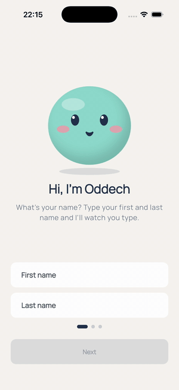
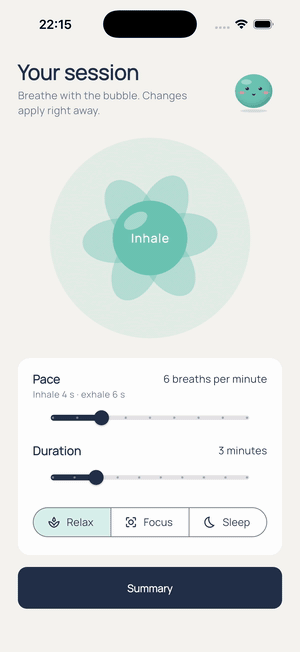
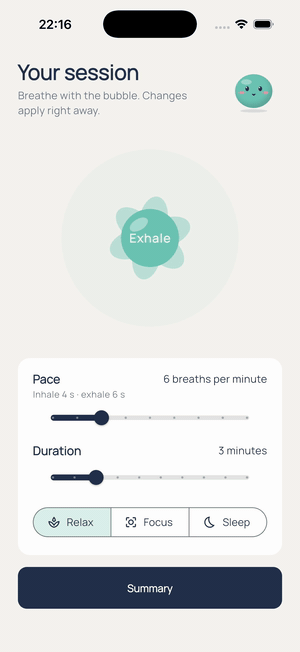

# Breath

A simple breathing exercise app.

On first launch there's a short onboarding where you enter your first name, last name and date of birth. Then you set the pace, duration and goal of the session, and the bubble in the middle of the screen breathes at the chosen rhythm. The summary fetches the profile from a (mocked) backend and shows the session plan together with the user's age. Animations are made in Rive.

<p>
  
  
  
</p>

## Running

Requires Flutter 3.50 (Dart 3.14).

```bash
flutter pub get
flutter run
```

Tests:

```bash
flutter test
```

Generated files are committed to the repo on purpose, so the project runs right away. After changing models, DI, routing or translations, regenerate them:

```bash
dart run build_runner build -d
```
